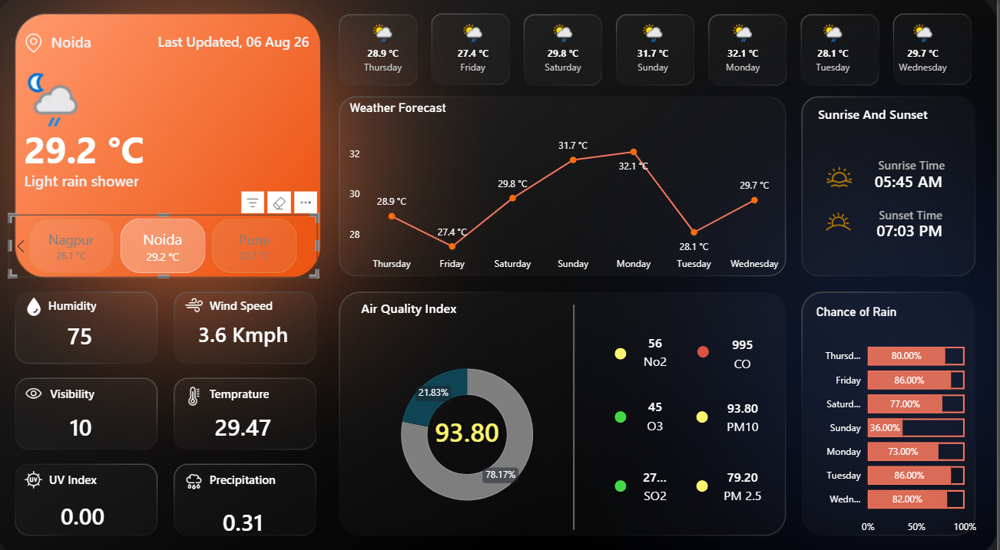

# 🌦️ Real-Time Weather & Air Quality Intelligence Dashboard

## 📌 Project Overview

An interactive Power BI dashboard that brings together current weather conditions, 7-day forecasts, astronomical information, and air quality indicators across multiple cities.

The project uses WeatherAPI to retrieve weather and air quality data, Power Query to transform the API responses, and DAX to create dynamic metrics and visual indicators.

## 🛠️ Tools & Technologies

- **Power BI Desktop** — Dashboard development and visualization
- **Power Query (M)** — Data extraction, cleaning, and transformation
- **DAX** — Measures and dynamic indicators
- **WeatherAPI** — Weather forecast and air quality data
- **REST API & JSON** — Data retrieval and processing

## 📸 Dashboard Preview

## 📊 Key Features

- **City Selection:** Switch between cities using an interactive slicer.
- **Current Weather:** View temperature, weather conditions, and the latest observation timestamp.
- **Weather Metrics:** Monitor humidity, wind speed, visibility, atmospheric pressure, and UV index.
- **7-Day Forecast:** Explore upcoming weather conditions and temperature trends.
- **Sunrise & Sunset:** View daily sunrise and sunset timings.
- **Precipitation Analysis:** Check the forecast probability of rain.
- **Air Quality Monitoring:** Track PM2.5, PM10, CO, NO₂, O₃, and SO₂ levels with color-coded indicators and contextual health advisories.

## 🧹 Data Preparation & Modeling

Weather data is retrieved from WeatherAPI and transformed using Power Query. The nested JSON responses are expanded, data types are standardized, duplicate records are handled, and the data is organized into current weather, daily forecast, and hourly forecast tables.

A location-based data model connects the weather and forecast tables, allowing the dashboard visuals to respond to city selections.

Hourly forecast data is prepared separately but is not displayed on the main dashboard, keeping the interface focused and easy to navigate.

## 💡 Key Learnings

- Working with REST APIs and nested JSON data in Power BI.
- Transforming and organizing data using Power Query.
- Building relationships between dimension and fact tables.
- Using DAX for dynamic metrics, formatting, and conditional indicators.
- Designing an interactive dashboard with a consistent dark theme.

## ⚠️ Note on Air Quality Indicators

The pollutant indicators use custom PM10-based thresholds for color coding and health advisories. They are intended for dashboard interpretation and should not be treated as an official EPA Air Quality Index calculation.

Weather data freshness depends on the API refresh configuration.

## 📁 Project Files

- **Power BI Report:** Add your `.pbix` file to the repository so users can download and explore the dashboard in Power BI Desktop.
- **Dashboard Preview:** Add a screenshot of the completed dashboard to an `Images` folder.

## 🙏 Acknowledgment

This project was developed by following and adapting concepts from The Developer BI's Power BI tutorial:

[Best Power BI Project End to End | Data Analyst Project (1 Hour)](https://www.youtube.com/watch?v=P8HB8dMfKNc)

The dashboard was customized to reflect my implementation and visual design choices.

---

**Created by Tanmay Khandait**  
[LinkedIn](https://www.linkedin.com/in/tanmay-khandait-45914b224) · [GitHub](https://github.com/Tanmayk30)
